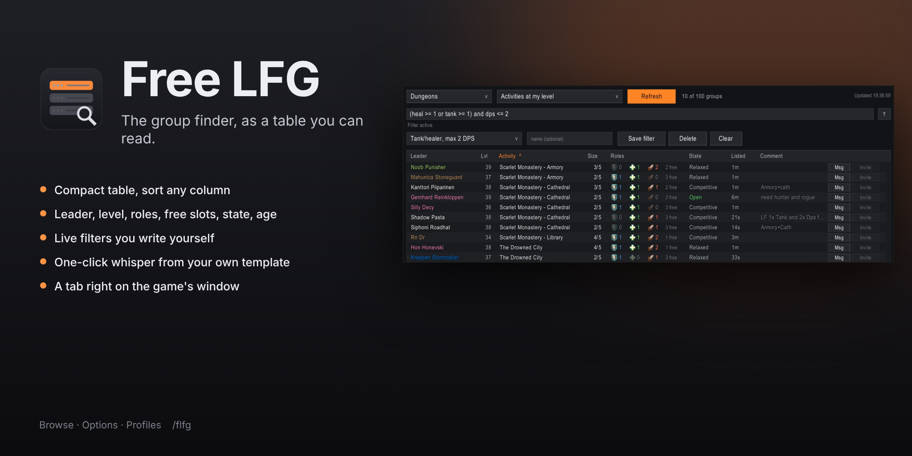
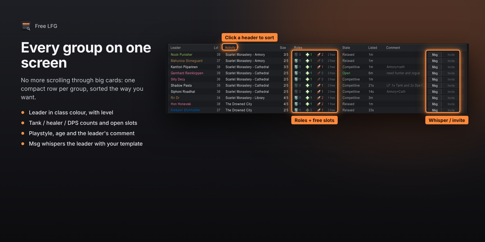
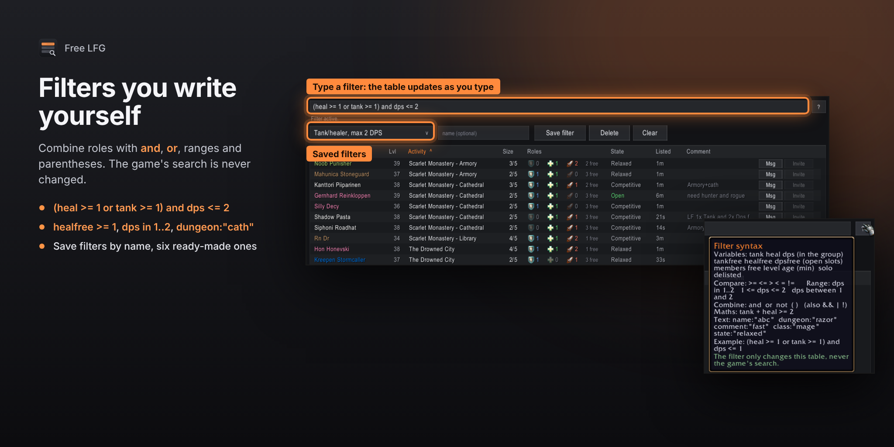
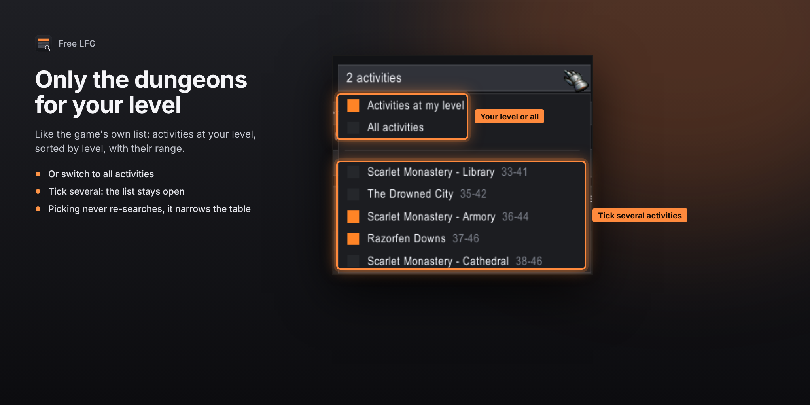
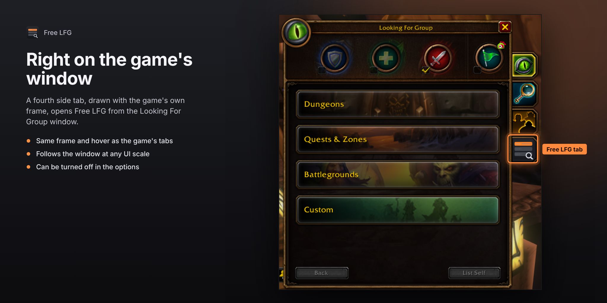
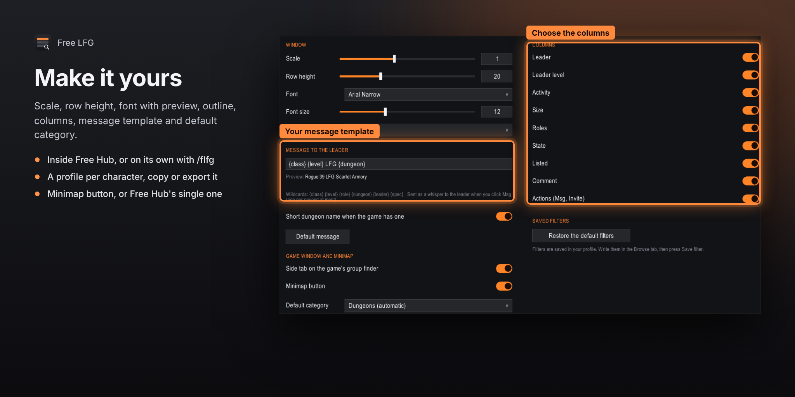

<h1 align="center">Free LFG</h1>

The group finder as a compact, sortable table: leader, roles, free slots, one-click whisper from a template, and live filters you write yourself.

<a href="https://www.curseforge.com/wow/addons/freelfg"><b>Download on CurseForge</b></a> · version <b>1.0.20</b> · WoW Forever (1.60.1) · <code>/flfg</code>

## Screenshots

<table>
<tr>
<td width="50%" valign="top"> <b>Every group on one screen</b> Sort any column; roles, free slots, state and age at a glance; whisper the leader in one click.</td>
<td width="50%" valign="top"> <b>Filters you write yourself</b> (heal &gt;= 1 or tank &gt;= 1) and dps &lt;= 2: the table updates as you type.</td>
</tr>
<tr>
<td width="50%" valign="top"> <b>Only the dungeons for your level</b> Activities at your level or all of them, tick several.</td>
<td width="50%" valign="top"> <b>Right on the game&#x27;s window</b> A Free LFG tab next to the game&#x27;s own, with the same frame.</td>
</tr>
<tr>
<td width="50%" valign="top"> <b>Make it yours</b> Columns, font, scale, message template and per-character profiles.</td>
</tr>
</table>

A readable Looking For Group window for WoW Forever: one compact table instead of a long list to scroll.

## The table

- One line per group: **leader** (class colour, level when the game gives it), **activity**, **size** (n/5, n/40), **roles** (tank / healer / DPS counts with icons, plus free slots), **state** (Relaxed, Competitive, Full, Delisted...), **time listed**, and the **title / comment**.
- Click a column header to sort, click again to reverse. Ties keep the game's own order.
- Pick a category and one or more activities (or "activities at my level"), then press **Refresh**. Free LFG also follows the searches done in the game's own window.
- Row height, font, font size, scale and visible columns are yours to set. Mouse wheel scrolling with a slim scroll bar. Hover a group for the full details and its members.

## Filter live, as you type

A box above the table filters the rows **instantly**. It only changes what the table shows, never the game's search.

- Variables: `tank`, `heal`, `dps` (in the group), `tankfree`, `healfree`, `dpsfree` (open slots per role), `members`, `free`, `level`, `age` (minutes), `solo` and `delisted` (1 or 0).
- Comparisons: `>= <= > < = !=`, ranges `dps in 1..2`, `1 <= dps <= 2`, `dps between 1 and 2`.
- Combine with `and` / `or` / `not` (or `&&` `||` `!`) and parentheses. Example: `(heal >= 1 or tank >= 1) and dps <= 1`
- Text: `name:"abc"`, `dungeon:"razor"`, `comment:"fast"`, `class:"mage"`, `state:"relaxed"`.
- A mistake in the text is shown in red with its position, and all rows stay visible until it is fixed.
- Save your own filters under a name and pick them from the list. A few useful ones come with the addon (Need a healer, Need a tank, Room for a DPS...).

## Message in one click

The **Msg** button whispers the leader with your template. Default: `{class} {level} LFG {dungeon}`

- Wildcards: `{class}` `{level}` `{role}` `{dungeon}` `{leader}` `{spec}`. A preview shows the result as you type.
- At most one message per second, so a double click does not send twice.
- **Custom** opens a whisper to the leader that already starts with your own beginning (default `{class} {level} `, same wildcards): type the rest and press Enter.
- **Invite** works for solo players looking for a group (when you are alone or the leader of your group). Groups are contacted with Msg.

## Options

- Message template and the beginning of the Custom message.
- Window scale, font (any LibSharedMedia font), font size, outline, row height, visible columns, default category.
- Profiles: each character has its own by default; copy, reset, export and import as text.
- Optional side tab on the game's group finder window that opens Free LFG, and a minimap button.

## Commands

- `/flfg` — open the table
- `/flfg help` — short help

## Free Hub

Free LFG works on its own. With **Free Hub** installed, it opens inside the hub next to the other Free addons, and a single minimap button replaces theirs.

**Want more fonts?** Install [SharedMedia Additional Fonts](https://www.curseforge.com/wow/addons/shared-media-additional-fonts) (or any LibSharedMedia font pack): its fonts appear automatically in the font list.

## Notes

- Built for WoW Forever. The game only lets an addon start a search from a click, so searching is always done with the **Refresh** button.
- Free LFG does not change how the game's finder works: it only reads its results and adds an optional side tab to its window.
- Bug reports and ideas are welcome in the comments.

## The Free suite

Addons for WoW Forever that share the same look, profiles and a single minimap button through Free Hub.

| | Addon | |
|---|---|---|
|  | **[Free Hub](https://github.com/DecardCainSuite/FreeHub)** — All the Free addons in one window: options side by side, product pages with gallery, and a single minimap button. | [CurseForge](https://www.curseforge.com/wow/addons/free-hub) |
|  | **[Free Unit Frames](https://github.com/DecardCainSuite/FreeUnitFrames)** — Fully customisable unit frames for player, target, focus, party, raid and bosses, with an ElvUI-style preset in one click. | [CurseForge](https://www.curseforge.com/wow/addons/freeunitframes) |
|  | **[Free Bars](https://github.com/DecardCainSuite/FreeBars)** — Up to 9 action bars, laid out as a grid or an arc, with mouseover fade, paging and a clean flat look. | [CurseForge](https://www.curseforge.com/wow/addons/freebars) |
|  | **[Free Swing](https://github.com/DecardCainSuite/FreeSwing)** — Swing timers for main hand, off hand and ranged, at exactly the size and style you want. | [CurseForge](https://www.curseforge.com/wow/addons/freeswing) |
|  | **[Free Minimap](https://github.com/DecardCainSuite/FreeMinimap)** — A rectangular minimap of any size, with a region map drawn from the game's own terrain tiles around you. | [CurseForge](https://www.curseforge.com/wow/addons/freeminimap) |
|  | **[Free Guild](https://github.com/DecardCainSuite/FreeGuild)** — Guild roster and rank tool for guild masters and officers: filters, bulk ranks, rules that promote for you, stats, raid rosters with attendance, guild info and notes. | [CurseForge](https://www.curseforge.com/wow/addons/freeguild) |
|  | **[Free LFG](https://github.com/DecardCainSuite/FreeLFG)** (this one) — The group finder as a compact, sortable table: leader, roles, free slots, one-click whisper from a template, and live filters you write yourself. | [CurseForge](https://www.curseforge.com/wow/addons/freelfg) |

## Changelog

What is new in the current version: [CHANGELOG.md](CHANGELOG.md). Full history: [CHANGELOG-history.md](CHANGELOG-history.md).

## Repository layout and releases

- The repository root is the addon folder (`FreeLFG/`), as installed in `Interface\AddOns`.
- `curseforge/` holds the CurseForge page: `description.md` (fields, gallery captions, description) and `images/` (logo, gallery, social preview). It is not shipped in the addon zip.
- `CHANGELOG.md` holds the notes of the version being prepared; they are sent to CurseForge as the file's changelog.
- Releasing: bump `## Version` in `FreeLFG.toc`, write `CHANGELOG.md`, then publish a GitHub release named `v<version>`. GitHub Actions packages the addon with the [BigWigs packager](https://github.com/BigWigsMods/packager) and uploads it to CurseForge and to the GitHub release.

Bug reports and ideas are welcome in the issues or in the CurseForge comments.
